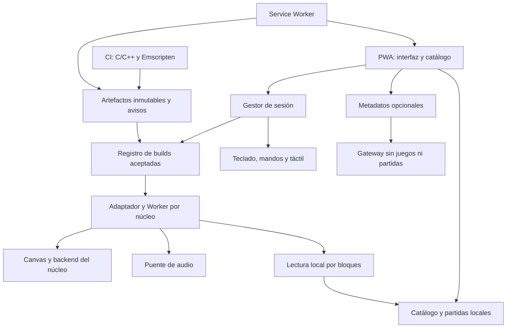

# Cartivo — Plan técnico maestro de la PWA multiconsola

> **Estado:** revisión 2; propuesta de arquitectura y alcance V1. No hay emuladores implementados ni benchmarks propios todavía.  
> **Fecha de revisión:** 30 de octubre de 2026.
> **Repositorio:** https://github.com/sempitern0/Cartivo
> **Base inspeccionada:** `2004f79f38d7a5196886b40136241a3e42fa39b6` (solo `.gitignore` y `LICENSE`).  
> **Tipo de producto:** PWA instalable por URL, *local-first*, multiplataforma, modular y sin ROMs, ISOs ni BIOS propietarias distribuidas.  
> **Audiencia:** ingeniería de software, emulación, producto, UI/UX, QA, seguridad y agentes de desarrollo (incluido Astra).

## 0. Resumen ejecutivo y reglas innegociables

Construir una plataforma web de emulación que permita al usuario **seleccionar una consola, escoger mando o teclado, seleccionar un juego propio, elegir una configuración de pantalla y jugar**. La app debe ofrecer resultados razonables sin ajustar parámetros manualmente, una biblioteca con carátulas regionales automáticas y una capa avanzada de personalización por juego.

### Requisitos P0

1. **Accesible desde una URL HTTPS e instalable donde el navegador/SO lo permita** con manifest, Service Worker, guía de instalación por plataforma y uso offline de la aplicación y de los núcleos descargados. El usuario aporta sus propios juegos adquiridos/obtenidos conforme a la legislación aplicable; **no** se suministran ni se enlazan ROMs comerciales.
2. **Sin exigir BIOS propietarias externas**. Preferir emuladores que no las necesiten o que implementen HLE. No ocultar problemas de compatibilidad derivados de HLE ni distribuir firmware de terceros. Si una consola no puede cumplir esta regla, permanece fuera de GA.
3. **Emulación local en el navegador**. ROMs/ISOs, estados de partida y datos del usuario no se envían al servidor. La conexión solo se utiliza para app, núcleos y metadatos/caratulas opcionales.
4. **Control sin fricción** con autodetección, configuración de teclado, perfiles de mando y soporte para varios jugadores cuando el núcleo lo permita.
5. **Rendimiento automático** por capacidad, juego y núcleo. Priorizar fluidez y audio correcto frente a efectos estéticos.
6. **Identificación de juegos** por *serial* interno (disco) y hashes (cartucho), con región, revisión, disco, título y carátula correctos.
7. **Ajustes por juego** persistentes; capas de mejora visual y de experiencia, sin prometer funciones inexistentes en el núcleo.
8. **Interfaz usable con teclado o mando**, localizable, accesible, adaptable a escritorio, tablet, móvil y pantallas grandes.

### No-objetivos de la primera versión

- Escribir un emulador nuevo de PS2 desde cero.
- Garantizar compatibilidad del 100 % con cualquier título, dispositivo o navegador.
- Exigir cuentas, servidor de juego, streaming de ROMs, sincronización en la nube o telemetría identificable.
- Redistribuir BIOS, ROMs comerciales, carátulas sin permiso o paquetes de núcleos sin respetar sus licencias.
- Anunciar como funcional una consola cuyo núcleo WASM no haya sido integrado y probado.

**Principio rector:** «Funciona sin configurar; se puede personalizar sin límites artificiales, pero solo dentro de las capacidades reales de cada núcleo».

---

## 1. Catálogo V1, ampliaciones y política de BIOS

**V1 se centra en diez consolas populares, agrupadas en nueve entradas de producto si GB y GBC comparten ficha.** Es una selección de alcance, no una clasificación de ventas. La popularidad no demuestra viabilidad web. Los candidatos de núcleo no son compromisos de distribución.

| Sistema / ID | Objetivo de lanzamiento | Candidato de evaluación | Condición específica, además de los gates comunes |
|---|---|---|---|
| NES / `nes` | V1 estable | FCEUmm / Nestopia; alternativa permisiva por evaluar | Cartuchos y mappers probados; Famicom Disk System excluido |
| Super Nintendo / `snes` | V1 estable | Snes9x / bsnes | Chips de expansión y condiciones de firmware por título; excluir variantes que exijan archivos propietarios externos |
| Game Boy / `gb` | V1 estable | mGBA / Gambatte | Mappers, SRAM y RTC; paletas coherentes |
| Game Boy Color / `gbc` | V1 estable | mGBA / Gambatte | Modo color, compatibilidad GB/GBC y RTC |
| Game Boy Advance / `gba` | V1 estable | mGBA | BIOS integrada libre, Flash/EEPROM/SRAM, RTC; no prometer cable link |
| Sega Master System / `sms` | V1 estable | Núcleo Sega auditado; Genesis Plus GX solo como candidato condicionado | Cartuchos y modos sin BIOS externa; no equiparar compatibilidad de todos los modelos |
| Sega Mega Drive / Genesis / `megadrive` | V1 estable | Genesis Plus GX / alternativa permisiva por evaluar | PAL/NTSC, mandos de 3/6 botones, audio; bloqueo de licencia no comercial |
| Nintendo 64 / `n64` | V1 beta, promoción individual a estable | Port de Mupen64Plus / Mupen64Plus-Next según evidencia | Backend gráfico web real, mando de 4 jugadores, EEPROM/SRAM/Flash y Controller Pak |
| PlayStation / `ps1` | V1 beta con HLE | PCSX-ReARMed u otro port HLE verificable | Memory cards y multidisco; compatibilidad HLE medida por revisión |
| PlayStation Portable / `psp` | V1 beta si supera spike | PPSSPP y su port web concreto | HLE sin BIOS, guardado Memory Stick, entrada analógica, backend web y rendimiento probados |
| PlayStation 2 / `ps2` | Laboratorio opt-in; fuera del compromiso GA V1 | Play! / Play!.js | HLE; prueba de guardado, lectura de ISO grande, compatibilidad y rendimiento por equipo |

**No se habilita ninguna consola solo para completar el catálogo.** Cada entrada requiere build reproducible, derechos de distribución compatibles, firmware permitido y validación de guardados. Si PSP/N64/PS1 no superan su gate, permanecen desactivadas con el bloqueo documentado; no retrasar indefinidamente las plataformas aceptadas ni publicitar las bloqueadas como jugables. Resolver cualquier recorte de la V1 en el registro de alcance antes de anunciarla.

### Qué significa «Sega» y qué se pospone

En V1 significa **Master System y Mega Drive/Genesis**. Game Gear se pospone aunque pudiera reutilizar núcleo: exige su propia UX y matriz de pruebas. Nintendo DS es popular pero pasa a V1.1 por la pantalla dual, entrada táctil y política de firmware; no se considera de nicho. Dreamcast también queda para una fase posterior por coste técnico. Saturn, 32X, Mega-CD, arcade/MAME, Neo Geo, Atari, PC Engine y accesorios especiales quedan fuera del trabajo inicial. No se crean adaptadores, menús vacíos ni spikes para ellos en V1.

### Política de BIOS y firmware

- Sin exigir ni distribuir BIOS propietarias externas. Se permite firmware libre reimplementado con licencia compatible y HLE del núcleo.
- Auditar por **sistema + modo + formato + juego**, no solo por nombre de emulador: expansiones, DSP y modos especiales pueden añadir requisitos.
- PPSSPP declara HLE y ausencia de BIOS obligatoria en su README; mGBA documenta una BIOS integrada y soporte GB/GBC/GBA. Eso no demuestra una integración web de Cartivo.
- Play! declara BIOS HLE integrada y versión web experimental. No extrapolar su compatibilidad nativa al navegador ni utilizar PCSX2 para prometer una PS2 sin BIOS.
- El port web puede carecer de JIT/recompilador utilizable: el JIT nativo no se traslada directamente a WASM. Medir intérprete, recompilación dinámica disponible y backends reales de PSP/N64/PS2.

### Estados separados de evaluación y soporte

`candidate → evaluating → accepted | blocked`. Solo `accepted` puede tener soporte `stable`, `beta` o `experimental`, siempre asociado a una build/plataforma. `unsupported` describe una combinación rechazada o no probada; no es una capacidad publicable. El estado inicial de todos los candidatos de este plan es **pendiente de evaluación**, no estable.

La política de propiedad intelectual puede bloquear el alcance: EmulatorJS declara GPLv3, PPSSPP GPL-2.0-or-later y Genesis Plus GX incluye restricciones no comerciales. Un Worker, iframe, dominio separado o descarga bajo demanda **no elimina** obligaciones de licencia. Véase ADR-005 antes de integrar o publicar binarios.

---

## 2. Experiencia del usuario: cinco decisiones, cero complejidad innecesaria

### Recorrido principal

```text
Abrir URL / iniciar PWA
      ↓
1. Elegir consola (o «Todos mis juegos»)
      ↓
2. Jugar con mando o teclado
   └─ Sugerir automáticamente el dispositivo detectado;
      permitir cambiarlo sin recalibrar todo.
      ↓
3. Elegir juego
   └─ Importar ROM/ISO si la biblioteca está vacía;
      identificación y carátula en segundo plano.
      ↓
4. Pantalla: Automático (por defecto) / Original / Mejorada
   └─ Ajustes avanzados opcionales
      ↓
5. Disfrutar
   └─ Inicio, pausa, continuar, guardar, salir
```

### Pantallas requeridas

1. **Inicio:** Continuar, Jugar, Consolas, Biblioteca, Ajustes. CTA único predominante.
2. **Selección de consola:** mosaicos simples; indicar `Estable`, `Beta`, `Experimental` con texto discreto; ocultar las no disponibles salvo en sección informativa.
3. **Control:** «Mando conectado» / «Teclado»; probar botones y remapear solo si es necesario.
4. **Biblioteca:** carátula, nombre, sistema, región, revisión, compatibilidad y última partida. Importación mediante archivos seleccionados por el usuario.
5. **Ficha de juego:** `Jugar` como acción principal; detalles y opciones específicas en panel desplegable.
6. **Pantalla previa:** `Automático` recomendado, `Pixel perfect`, `Aspecto original`, `Pantalla completa ajustada`, `Mejorado` (cuando aplicable). El aspecto original depende del sistema; no imponer 4:3 a las portátiles.
7. **Overlay de juego:** pausa, reanudar, guardar/cargar, controles, vídeo/audio, rendimiento, salir. No interferir con el renderizado.
8. **Compatibilidad:** avisos claros de núcleo experimental, necesidad de reiniciar o función no soportada.

### UX obligatoria

- Navegación completa sin ratón con D-pad, sticks, teclado, Enter/A/Escape/B.
- Diferenciar tecla de **acción** de tecla de **retroceso**, independientemente del layout del controlador.
- Mando desconectado: pausar automáticamente si es seguro y mostrar recuperación.
- Soporte P1/P2/P3/P4 según núcleo, configuración individual, hot-plug, reasignación y detección de entrada fantasma.
- Componentes adaptativos, contraste AA, tamaños de objetivo táctil, idioma español/inglés, texto no truncado y `prefers-reduced-motion`.
- Persistir la última consola, dispositivo, juego y modo de pantalla; opción de desactivar el autoinicio.
- Evitar configurar conceptos técnicos como «síncrono de VBlank», «JIT» o «filtrado anisotrópico» en el recorrido principal.

---

## 3. Arquitectura políglota y distribución

### Decisión propuesta

**Monorepo pnpm + TypeScript estricto + Svelte/Vite sin SSR**, frontend estático y núcleos C/C++ compilados a WASM con Emscripten. El framework no participa en el bucle de emulación. Python se reserva para herramientas de importación de datos, build y análisis; no se añade un servidor Python, Rust ni microservicios sin una necesidad demostrada. Un gateway pequeño en TypeScript es opcional para metadatos y secretos.

El monorepo coordina código propio, contratos y recetas, pero cada núcleo se compila y versiona independientemente. Los artefactos distribuidos se publican por hash; no se compila C++ al cargar la aplicación ni se descarga el conjunto de emuladores durante la instalación.



### Fronteras y tecnologías

| Componente | Tecnología | Responsabilidad | Prohibición / frontera |
|---|---|---|---|
| Interfaz | Svelte + TS + CSS | Flujo de cinco pasos, biblioteca, foco, overlay e i18n | No importa APIs internas C/C++ ni bloquea con hashing |
| Dominio y orquestación | TS sin framework | Identidad, perfiles, selección de build y lifecycle | No conoce DOM ni globals de un emulador |
| API y protocolo | Tipos TS + schemas runtime | Eventos versionados, comandos, errores y capacidades | No intercambia funciones ni punteros WASM entre hilos |
| Adaptadores | TS/JS y pequeño puente C cuando haga falta | Traducción de ABI, memoria, input, vídeo, audio y guardados | Un módulo Emscripten por sesión; sin estado global compartido |
| Núcleos | C/C++ → WASM | CPU/GPU/audio emulados y lógica propia | Versiones y dependencias fijadas; nada de `latest` |
| Entrada/salida local | Workers + OPFS/IndexedDB | Parsing, lecturas por bloques, commits y recuperación | Ninguna ROM, ruta local ni save viaja al gateway |
| Audio | AudioWorklet cuando el port lo permita | Cola acotada y presentación de muestras | No duplicar el AudioContext o mixer que ya controle un port |
| Publicación | Hosting estático + almacenamiento de artefactos | HTTPS, MIME WASM, COOP/COEP, CSP, versiones y rollback | El proveedor debe servir cabeceras reales, no solo meta tags |
| Gateway opcional | TS en runtime administrado | Credenciales, cuota y proxy de proveedores autorizados | Sin subida de binarios; sin proxy de URLs arbitrarias |
| Tooling | Emscripten/CMake + Python y scripts | Builds aisladas, SBOM, hashes y datos licenciados | Herramientas fuera del bundle de usuario |

### Dependencias y distribución del repositorio

```text
apps/web/                         PWA y composición de servicios
apps/metadata-gateway/            opcional; añadir cuando exista proveedor autorizado
packages/domain/                  identidad, perfiles y estados sin dependencias web
packages/emulation-api/           protocolo, schemas, tipos y códigos de error
packages/runtime/                 sesiones, registro, selección y transporte
packages/adapters/<core-id>/       integración por núcleo
packages/input/                   mando, teclado, táctil y foco
packages/media/                   presentación, audio y efectos propios
packages/library/                 ingestión, formatos, identificadores y proveedores
packages/storage/                 catálogo, archivos, saves y backups
packages/diagnostics/             capacidades y mediciones locales
cores/<core-id>/                  receta, commit upstream, parches y lock de toolchain
registry/                         manifiestos validados; builds aceptadas únicamente
tools/                            builds y verificación de artefactos
tests/fixtures/                   homebrew/fixtures con licencia y procedencia
tests/e2e/                        regresión de producto y navegador
docs/adr/                         decisiones y bloqueos
docs/compatibility/               evidencias y matrices reproducibles
```

Crear paquetes cuando exista su primer consumidor; no generar decenas de carpetas vacías. Dirección permitida: `apps → servicios/runtime/adaptadores → emulation-api/domain`; el dominio nunca importa UI, los adaptadores no se importan entre sí y el runtime descubre adaptadores por factories registradas. pnpm workspaces y un lockfile bastan al inicio; posponer Nx/Turborepo hasta medir necesidad.

### Ejecución y costes de transferencia

- Una sesión de juego activa. Detener y liberar la anterior antes de abrir otra: memoria WASM, buffers, handles, listeners, GPU, Workers y audio. Una sesión no se comparte entre pestañas.
- Host crea Worker y transfiere `OffscreenCanvas` cuando el backend lo soporte. Si el port exige canvas/DOM en main thread, usar ruta específica evaluada o bloquear esa build: no afirmar que todo núcleo funciona en Worker.
- El núcleo es dueño de su renderer. Un emulador 3D puede presentar directamente en WebGL; no forzar readback GPU→CPU→GPU para un postprocesado universal. Integrar filtros solo con una ruta de composición demostrada y medida.
- Input: sondeo Gamepad API desde host, snapshots tipados y neutrales al perder foco. `postMessage` agrupado es baseline; SharedArrayBuffer/Atomics solo para builds compatibles, con protocolo y contadores. No RPC por botón/píxel/muestra.
- Audio: cola acotada con contadores de underrun/overrun. Anillo compartido si hay aislamiento; buffers transferibles reutilizados si el adaptador admite esa ruta. No bloquear AudioWorklet con IO, RPC o asignaciones grandes.
- Hilos y SIMD son ejes de artefacto distintos: `baseline`, `simd`, `threads`, `simd-threads` solo donde se construyan y validen. Emscripten exige builds separadas para ejecución con y sin pthreads; no existe fallback automático del mismo binario.
- Los Workers del mismo origen no son un sandbox de permisos: pueden acceder a APIs del origen. Solo ejecutar núcleos auditados y fijados. Si se necesitan plugins no confiables, diseñar origen aislado y permisos explícitos antes de admitirlos.

### Canales de publicación

1. **Shell:** HTML/JS/CSS/manifest/SW estáticos, pequeños y navegables sin núcleos instalados.
2. **Runtime packs:** `<core-id>/<upstream-commit>/<build-id>/` con JS, WASM, workers/data, schema, checksum, fuentes/avisos exigidos y manifest. Descarga al primer uso con tamaño y cancelación visibles; pin explícito para offline.
3. **Datos opcionales:** DATs y perfiles permitidos, independientes de releases de UI. Metadatos y carátulas con licencia y cuota separadas.
4. **Gateway:** opcional y desplegado aparte; su caída no impide arrancar juegos ya disponibles.

Mismo origen para shell y packs por simplicidad inicial. CDN de otro origen solo con CORS/CORP y pruebas COEP. No usar GitHub Pages como despliegue supuesto sin comprobar que la estrategia satisface las cabeceras requeridas; no resolverlo con trucos de SW sin ADR y validación.

---

## 4. Contrato de núcleos y «controlar todos los parámetros»

No existe una API universal que permita modificar cualquier variable de todos los juegos y emuladores. El objetivo correcto es **exponer exhaustivamente lo que permite cada núcleo, añadir capas independientes y soportar extensiones específicas por juego**.

### Esquema conceptual (TypeScript)

```ts
type SupportLevel = 'stable' | 'beta' | 'experimental';
type SettingScope = 'global' | 'system' | 'core' | 'game' | 'session';

type CoreCapability =
  | 'save-data' | 'save-state' | 'disc-swap' | 'rewind'
  | 'fast-forward' | 'cheats' | 'patches' | 'rumble'
  | 'multiplayer' | 'internal-resolution' | 'gpu-renderer'
  | 'widescreen-patch' | 'frame-skip' | 'screenshots';

interface CoreManifest {
  id: string;
  version: string;
  systems: string[];
  support: SupportLevel;
  biosPolicy: 'none' | 'hle'; // requisito del producto: sin BIOS externa
  formats: string[];
  capabilities: Partial<Record<CoreCapability, boolean>>;
  settingsSchemaVersion: number;
  wasmArtifacts: {
    buildId: string; url: string; sha256: string;
    threaded: boolean; simd: boolean;
    protocolVersion: number; stateFormatId: string;
    renderer: string; execution: 'worker' | 'main-thread';
    requiredFeatures: string[];
  }[];
  browserRequirements: string[];
  license: { expression: string; sourceUrl: string; noticesUrl: string; review: 'pending' | 'approved' | 'blocked' };
}

interface EmulatorSession {
  load(game: GameSource, profile: EffectiveProfile): Promise<void>;
  start(): Promise<void>;
  pause(): Promise<void>;
  resume(): Promise<void>;
  reset(): Promise<void>;
  stop(): Promise<void>;
  setInput(port: number, input: NormalizedInput): void;
  updateSettings(patch: Record<string, unknown>): Promise<SettingsResult>;
  getCapabilities(): Readonly<CoreManifest['capabilities']>;
  getMetrics(): PerformanceSnapshot;
  dispose(): Promise<void>;
}
```

Los tipos `GameSource`, `EffectiveProfile`, `NormalizedInput`, `SettingsResult` y `PerformanceSnapshot` deben definirse antes de implementar adaptadores; este fragmento es un **borrador de contrato**, no código compilable de producción.

### Protocolo y ciclo de vida verificables

El contrato anterior sigue siendo conceptual; no se publica como paquete compilable hasta definir todos sus tipos. Añadir operaciones de exportación/importación de save data y save state independientes, schema de ajustes, selección de disco y eventos de cambios de capacidad. Distinguir soporte del núcleo de soporte de **build + navegador + juego**.

Cada mensaje incluye `protocolVersion`, `sessionId`, `requestId`, `type` y payload validado. Rechazar respuestas de sesiones antiguas, mensajes sobredimensionados y comandos fuera de estado. Timeouts y cancelación deben liberar recursos; después de un fallo se crea una sesión nueva, no se reutiliza memoria dudosa.

Estados: `idle → preparing → loading → ready → running ↔ paused → stopping → stopped`, con transición a `failed` desde cualquier fase activa. `dispose` es idempotente; `stop` intenta confirmar persistencia antes de terminar el Worker. Al forzar terminación, indicar que solo se conserva el último commit de save confirmado.

Separar opciones `live`, `reset`, `reload` y capacidades condicionales. Prohibir que la precedencia de preferencias elimine guardas obligatorias de compatibilidad; un override riesgoso exige acción explícita y queda visible. Rewind, cheats, parches y texture packs pasan a V1.x: el contrato prevé capacidades, V1 prioriza jugar y conservar partidas.

### Catálogo de ajustes por capas

| Capa | Opciones propuestas | Límites |
|---|---|---|
| Pantalla | 4:3, 16:9 ajustado, integer scaling, pixel-perfect, overscan, fullscreen, rotación, filtros CRT/scanlines | 16:9 no debe estirar por defecto; algunos son posprocesado, no resolución interna |
| Render | Resolución interna 1×/2×/3×/4×… si core, WebGL2/WebGPU si disponible, texturas, filtrado | Solo si el core expone dicha característica |
| Tiempo | Región auto PAL/NTSC, velocidad, frameskip, VSync según soporte | Alterar 50/60 Hz no equivale a mejorar FPS reales del juego |
| Audio | Volumen, latencia, mezclador, interpolación, mute de fondo | Preservar sincronización y calidad sin underruns |
| Entrada | Mapeos, turbo, dead zones, sensibilidad, inversión, vibración | Accesorios específicos pueden requerir adaptadores dedicados |
| Experiencia | Guardado rápido, estados, capturas, reanudar, rebobinado | Rewind y save states dependen del core y consumen memoria |
| Juego | Parches IPS/BPS/UPS si aplicables, trucos opt-in, mejoras widescreen específicas | No alterar el archivo original; validar hash y versión del parche |
| Diagnóstico | FPS emulado, FPS presentado, frame time, audio underruns, memoria | Telemetría local por defecto |

### Precedencia de perfiles

`defaults verificados → perfil de hardware → sistema → núcleo → identificación exacta de juego/revisión → preferencia del usuario → ajuste temporal de sesión`.

- Mantener **opción de restablecer** por juego y global.
- Marcar ajustes como `live`, `requires-reset`, `requires-reload` o `unsupported`.
- Rechazar opciones fuera del schema; no aceptar parámetros arbitrarios directamente en WASM.
- Versionar perfiles y migrarlos con tests de regresión; guardar core y versión utilizados en cada save state.
- Guardar el origen de cada override (`auto`, `manual`, `compatibility-fix`) y su justificación.
- Las mejoras que alteren mecánicas, temporización o fidelidad deben estar **desactivadas por defecto** si no existe validación.

---

## 5. Biblioteca, identificadores, regiones y carátulas

### Ingesta y detección

1. Solicitar selección explícita de archivo(s) o carpeta si la API del navegador lo permite. Si no permite directorios, usar selector múltiple; ofrecer importación manual universal.
2. Detectar tipo real por **cabecera y estructura**, no solo extensión. Validar contenido y tamaño antes de cargar.
3. Agrupar correctamente `BIN+CUE`, `M3U`, pistas de audio y discos múltiples; soportar CHD solo cuando el core/lector lo admita. Advertir de referencias rotas.
4. En cartuchos calcular incrementalmente CRC32 + SHA-1 (o hash apropiado) y consultar bases locales con atribución/licencia; normalizar cabeceras si DAT lo requiere, conservando también el hash del archivo original.
5. En N64 reconocer `.z64`, `.v64` y `.n64`, normalizar endianness en una vista o stream sin modificar el archivo original y conservar hash original + hash normalizado. Headers GB/GBC/GBA o Mega Drive aportan indicios, pero no son identificadores únicos ni garantizan región. Separar contenido modificado de edición original; la coincidencia por nombre tiene confianza baja.
6. En discos leer **ID interno** sin hash completo siempre que sea viable: PS1/PS2 `SYSTEM.CNF` y ejecutable, PSP `PARAM.SFO`/estructura UMD, además de metadatos específicos por sistema.
7. Normalizar seriales y prefijos (`SLUS`, `SCUS`, `SLES`, `SCES`, `SLPS`, `SLPM`, etc.) sin inferir equivocadamente que un prefijo identifica por sí solo la región final del contenido.
8. Resolver mediante `(system, serial, region, revision, disc_number, hash)` y vincular una entrada canónica del juego a una **edición concreta**.
9. Si no hay coincidencia: búsqueda manual, carátula genérica y posibilidad de corregir datos localmente. **Nunca sustituir una coincidencia incierta por una carátula de otra región sin avisar.**

### Fuentes de datos: estrategia de adaptadores

- **Libretro Database / Thumbnails:** base para CRC/serial/nombre. **Importante:** los thumbnails se indexan normalmente por *nombre canónico*, no por serial directamente: resolver identificador → título canónico → nombre del recurso. Comprobar condiciones de distribución de datos y arte.
- **ScreenScraper:** API permite CRC, MD5, SHA-1, tamaño, nombre y `serialnum`, además de carátulas y preferencia regional. **Requiere credenciales de desarrollador y cumplimiento de las condiciones**; nunca incrustarlas en el JS público. El acceso gratuito está sujeto a condiciones del proveedor.
- **GameTDB y otras fuentes:** solo tras evaluar permiso de uso en una **web/PWA pública**, no extrapolar permiso para software de escritorio a un sitio web. La FAQ de GameTDB pide permiso para webs.
- **Proveedores opcionales adicionales:** incluir únicamente tras una revisión formal de cuota, API, atribución, copyright, privacidad y caché.

**Regla operativa:** si no es posible usar legalmente un proveedor, la aplicación sigue funcionando sin él (datos locales, carátula genérica o portada cargada por el usuario).

### Modelo de datos (conceptual)

```json
{
  "gameId": "uuid-local",
  "systemId": "ps2",
  "displayTitle": "Título identificado",
  "edition": {
    "serial": "SLES-XXXXX",
    "region": "EU",
    "revision": "1.0",
    "discNumber": 1,
    "discCount": 2,
    "languageCodes": ["es", "en"]
  },
  "content": {
    "fileType": "iso",
    "sizeBytes": 0,
    "hashes": { "crc32": null, "sha1": null },
    "storageMode": "external-handle"
  },
  "metadata": {
    "provider": "licensed-provider-id",
    "providerGameId": "external-game-id",
    "matchConfidence": null,
    "coverRegion": "EU",
    "coverLicense": "subject-to-provider-terms"
  },
  "compatibility": { "coreId": "play-web", "status": "untested" }
}
```

*La entrada anterior es una plantilla, no un título ni un serial verificados. No inventar porcentajes de confianza: registrar método de coincidencia, evidencia y ambigüedad; calibrar scores antes de presentarlos como probabilidades.*

### Fallback regional

`edición exacta + región → edición exacta sin cover regional → mismo título + misma región (confirmación) → portada genérica → portada del usuario`.

Si el usuario elige «EU», no reemplazar silenciosamente la carátula con USA cuando la diferencia tenga relevancia; ofrecer una acción explícita para aceptar una portada alternativa.

### Rendimiento y privacidad de la biblioteca

- Importación no bloqueante en Worker, progreso y cancelación; no calcular hashes de ISOs gigantes si el serial es suficiente.
- Cache de metadatos y miniaturas con cuota/LRU y atribuciones; artwork separado de saves.
- No subir el binario del juego ni rutas del dispositivo. Compartir serial/hash con proveedores **solo con transparencia y control del usuario**.
- Manejar colisiones, traducciones, hacks, homebrew, revisiones, juegos multidisco y ediciones que compartan número de serie.
- Backups de biblioteca y overrides en JSON versionado; imágenes con derechos de terceros solo si las condiciones permiten reexportación.

---

## 6. Archivos, grandes imágenes de disco y offline

### Persistencia y acceso

- **ROMs pequeñas:** permitir importación a OPFS bajo consentimiento, o referencia al archivo seleccionado.
- **ISO/CHD/CSO grandes:** preferir lectura por bloques (`Blob.slice`, lectura aleatoria y precarga limitada) desde archivo autorizado, para evitar duplicar gigabytes en heap WASM; implementar `seek/read` adaptado al core.
- **Compatibilidad:** `showDirectoryPicker`/File System Access cuando exista; selector múltiple `<input type=file>` como fallback. Los permisos de handles pueden caducar y requerir selección de nuevo.
- **OPFS:** datos privados del origen y sujetos a cuotas/borrado. Usar `navigator.storage.estimate()` y solicitar `navigator.storage.persist()` cuando proceda, sin tratarlo como garantía absoluta.
- **Guardados:** separar SRAM/memory cards de save states; exportar/importar; commits recuperables, checksum, versiones, back-up periódico local y recuperación tras fallo. No asumir renombrado atómico universal de OPFS.
- **Servicio offline:** almacenar app shell, fuentes de licencia adecuada, recursos y núcleos usados. El Service Worker **no descarga ni almacena juegos externos**.
- **Actualización:** descargar nuevo core de forma atómica, comprobar integridad y preservar core anterior si existe incompatibilidad de save states.

### Lectura de discos y presupuesto de memoria

`Blob.slice().arrayBuffer()` es asíncrono; muchos núcleos esperan un `read/seek` síncrono. El adaptador debe demostrar una de estas rutas: OPFS con handle síncrono en Worker y copia de archivo consentida, filesystem Emscripten compatible con acceso de archivo, Asyncify/JSPI evaluado en la build y navegadores objetivo, o puente de IO dedicado con memoria compartida. No presentar `Blob.slice` como solución automática para un port que precarga todo a MEMFS.

Por build registrar tamaño comprimido, heap inicial/máximo, formato y patrón de lectura, máximo archivo probado y copias simultáneas estimadas. Objetivo de spike: ISO de tamaño representativo sin asignación proporcional al tamaño completo y sin bloqueo de UI. Si no es posible, publicar límite medido y rechazar antes de intentar cargar. Un índice de CSO/CHD y su descompresor necesitan presupuesto propio; V1 comienza por formatos simples, los comprimidos se habilitan solo tras pruebas.

Para hashing grande usar implementación incremental en Worker: `crypto.subtle.digest` no ofrece hashing streaming universal y no justifica cargar gigabytes en RAM. Progreso/cancelación y lecturas acotadas también para ZIP; los archivos comprimidos no son requisito para el primer incremento.

### Guardados resistentes a fallos y a varias pestañas

- SRAM/EEPROM/Flash, memory cards, Controller Pak y Memory Stick son **save data**; save states capturan la build y no son intercambiables por defecto.
- Namespace de save data: sistema + identidad de contenido/edición + perfil de usuario local + formato. Los states añaden `coreId`, `buildId`, `stateFormatId`, checksum y metadatos de compatibilidad; conservar build anterior cuando haga falta.
- Commit: escribir nueva generación en OPFS, finalizar y comprobar bytes/hash; después actualizar el puntero de generación confirmada en una transacción IndexedDB. Conservar al menos la última generación buena y la anterior. Tras crash ignorar generaciones incompletas y permitir restauración. Probar fallos entre cada paso; no afirmar transacción conjunta OPFS/IndexedDB.
- Bloqueo de escritor por juego con Web Locks cuando esté disponible y coordinación/fallback de pestañas explícito. Ante duda, segunda pestaña en modo lectura o bloquear inicio; no permitir sobrescrituras silenciosas.
- Guardar al recibir cambios del núcleo y con checkpoints limitados. No depender de `beforeunload`: móvil puede matar el proceso sin evento. Pausa/salida intentan flush; suspensión solo ofrece el último checkpoint confirmado.
- Si falla persistencia o hay cuota insuficiente, mostrar modo temporal antes de jugar y facilitar exportación. Nunca informar «Guardado» antes de confirmar commit.

### Offline y actualización coherente

Instalar una PWA no descarga todas las ROMs ni todos los núcleos. Offline requiere shell + build elegida + archivos locales accesibles; un `File` seleccionado puede requerir reselección al reiniciar. La UI muestra disponibilidad offline por juego y ofrece copiar a OPFS con tamaño y consentimiento.

El SW instala un manifiesto de release con hashes y contrato compatible con el runtime; solo activa una release completa. No ejecutar `skipWaiting`/reload durante una partida. La nueva versión espera fin de sesión y confirmación de guardado. Probar dos pestañas con versiones distintas. Mantener packs fijados por estados/partidas y permitir rollback; el LRU solo expulsa artefactos prescindibles y metadatos, jamás saves. Un checksum solo protege integridad respecto de un manifiesto confiable: no sustituye HTTPS ni control del origen.

### Cabeceras de despliegue (cuando se requieran hilos WASM)

```http
Cross-Origin-Opener-Policy: same-origin
Cross-Origin-Embedder-Policy: require-corp
Content-Security-Policy: default-src 'self'; script-src 'self' 'wasm-unsafe-eval'; worker-src 'self'; connect-src 'self'; img-src 'self' blob:; style-src 'self'; object-src 'none'; base-uri 'self'; frame-ancestors 'none'
```

Añadir `Content-Type: application/wasm`, compresión negociada, caché inmutable por hash y revalidación para HTML/SW. La CSP anterior es un **punto de partida propuesto, todavía no probado**: ampliarla de manera mínima según workers, imágenes, WASM y conexiones realmente utilizadas. Verificar `crossOriginIsolated` y compatibilidad de assets externos (CORS/CORP). No dar por supuesto que estas cabeceras bastan en Safari/iOS o que `require-corp` permitirá fuentes externas de carátulas sin adaptación.

---

## 7. Entrada: gamepads, teclado, múltiples usuarios

### Input Abstraction Layer

- Audio y fullscreen requieren activación de usuario según navegador; `Jugar` inicia/desbloquea audio y comprueba resultado. No prometer autoinicio con audio.
- Normalizar Gamepad API (`mapping: standard` cuando exista), botones, ejes, gatillos, pulsaciones, desconexión y hot-plug.
- Adaptadores de perfiles de mando **por capacidades reales del navegador**: Xbox/XInput donde se exponga, DualShock/DualSense, 8BitDo, Nintendo Pro/Joy-Con y genéricos HID; no prometer soporte universal ni vibración en cada plataforma.
- Binding **físico → virtual** por jugador, consola y juego: `Pad 1 -> port 1`, `Keyboard -> port 2`, etc. Evitar capturas involuntarias de teclas reservadas por navegador/OS.
- Calibración de deadzones, inversion de ejes, gatillos analógicos y sensibilidad; mostrar prueba de input integrada.
- Pantalla táctil virtual para sistemas 2D y juegos apropiados; ocultar controles si hay mando. DS se diseña en una iteración posterior; PS2 móvil solo si el rendimiento y entrada están validados.
- Haptic feedback opcional mediante API disponible y conmutador, nunca requisito.
- Soportar hotkeys con combinaciones accesibles que no interfieran con el juego (pausa, guardar, menú, fullscreen).
- Muestrear entrada de forma sincronizada con la sesión de emulación y desacoplar el polling UI cuando sea necesario.

### Criterios específicos

- Configuración del mando **sin usar ratón**.
- Dos mandos iguales, conexión y desconexión en juego, reasignación de puertos.
- Prueba de teclado internacional (ES/US), repetición de teclas y pérdida de foco.
- No asumir que un gamepad conectado puede utilizarse antes de la primera interacción del usuario con la página.

---

## 8. Vídeo, audio y mejoras visuales

### Resoluciones

Distinguir entre:

1. **Resolución interna emulada:** magnificación 1×/2×/3×/4×… solo en cores que la permitan.
2. **Escalado de salida:** adaptar imagen a viewport y DPI, con pixel-perfect entero cuando sea apropiado.
3. **Resolución física de pantalla:** el navegador no cambia libremente el modo de vídeo del monitor; ofrecer fullscreen, tamaño de canvas y escalado, no prometer cambio de modo del sistema.

Perfiles de salida: `Auto`, `Original (aspecto correcto)`, `Pixel perfect`, `Llenar sin deformar`, `CRT/retro`, `Mejorado 3D`. Nunca deformar 4:3 a 16:9 por defecto. Widescreen real mediante parches por juego, **no estiramiento**, y solo para versiones compatibles.

El perfil distingue resolución de framebuffer, relación de píxel y aspecto de presentación. GB/GBC (160×144) y GBA (240×160) conservan sus proporciones portátiles; PSP tiene framebuffer 480×272 y perfil de pantalla panorámico. NES/SNES/Sega/N64/PS1 pueden requerir corrección de aspecto según modo/región: no deducirlo siempre de ancho/alto del framebuffer. Validar con patrones geométricos, overscan y cambios de modo del juego.

### Pipeline audiovisual

Ruta 2D cuando el adaptador la admita: `framebuffer → textura → escalado/filtro opcional → presentación`, con UI en una capa independiente. En 3D preferir presentación directa del renderer del núcleo y efectos solo si su integración no introduce readback costoso.  
Ruta de audio cuando el port permita controlarla: `muestras → cola acotada → AudioWorklet → salida`, con sincronización gobernada por la política del core; en otros ports adaptar su grafo existente y declarar capacidades limitadas.

- Evitar postprocesados que añadan latencia por defecto.
- Permitir CRT, scanlines, color grading, bilinear/nearest, máscaras de píxel, overscan y shaders opcionales.
- Comprobar pérdida y restauración de contexto GPU, fullscreen, resize, DPI alto, minimización y retorno de foco.
- El selector de renderer debe ser **capability-driven**: no mostrar WebGPU donde el port no tenga backend WebGPU.
- Medir *end-to-end latency* por separado de FPS.

---

## 9. Autoconfiguración de rendimiento y compatibilidad

### Detector de capacidades

Evaluar en runtime: hardwareConcurrency (orientativo), RAM indicativa cuando haya API, `crossOriginIsolated`, WASM SIMD, WASM threads, WebGL2, WebGPU (si procede), tamaño de pantalla, refresh rate disponible, capacidad de almacenamiento, política de energía y disponibilidad de AudioWorklet. **No usar un User-Agent o benchmark único como verdad absoluta.**

### Modos automáticos

| Perfil | Política de inicio | Escalado | Efectos | Criterio |
|---|---|---|---|---|
| `compatibility` | Port WASM más portable y single-thread si es necesario | Original / 1× | Off | Entorno limitado o no aislado |
| `balanced` | Core recomendado, audio estable | Auto / 1–2× si core | Opcionales ligeros | Perfil por defecto |
| `quality` | Núcleo/render más exigente si está medido | 2–4× según núcleo | Calidad escalonada | Hardware con margen probado |
| `custom` | Ajustes elegidos por usuario | Manual | Manual | No sobrescribir sin permiso |

**Bucle de ajuste adaptativo (sin oscilaciones):** observar FPS emulado vs nominal (50/60 según región y juego), *frame time*, underruns y dropped frames durante una ventana suficiente; reducir primero postprocesado y resolución interna, luego ajustes de core compatibles; aplicar *hysteresis/cooldown*. **No modificar la velocidad del juego o el audio silenciosamente para cumplir FPS.**

### Perfil por juego

- Base de compatibilidad con `(system, serial/hash, revision, core-version, browser-family, device-class)`.
- Correcciones de compatibilidad versionadas y auditables: cambios conservadores e informados, con posibilidad de deshacer.
- Si falla la ejecución, sugerir otro core **solo si cumple BIOS, licencia y browser requirements**; mostrar diagnóstico claro.
- No activar funcionalidades que rompan determinismo del estado sin tests.

### Objetivos medibles (metas de producto, no garantías)

- UI de entrada y navegación: respuesta perceptible inmediata, sin bloquear el hilo principal por carga de ROM.
- Núcleos 8/16 bits en los dispositivos de referencia: velocidad emulada nominal en la batería de juegos de prueba.
- PS1/PSP: velocidad nominal en una **matriz de hardware y juegos representativa**, con porcentaje de éxito publicado.
- PS2: medir por título y navegador; lanzamiento **experimental**, sin promesa de velocidad nominal general.
- Cero pérdida de partidas en la batería de pruebas de reinicio/actualización; exportación funcional siempre que exista save.

---

## 10. Seguridad, propiedad intelectual y privacidad

- **Modelo de amenazas:** archivos de juego manipulados, parsers nativos compilados a WASM, save states maliciosos, imágenes remotas, terceros de metadatos, DoS por consumo de memoria y supply chain de núcleos.
- Validar magic bytes, tamaños, referencias CUE/ISO, rutas y límites de descompresión; evitar *zip bombs*, path traversal y procesamiento ilimitado.
- Ejecutar código emulador auditado en Worker con timeouts/abort y limpieza de recursos. Un Worker del mismo origen comparte acceso a APIs de almacenamiento y red; no representa aislamiento de privilegios. WASM no equivale a seguridad automática.
- Limitar CSP, orígenes, permisos, dependencias, SRI/integridad de bundles, firma/checksum de releases y versiones fijadas.
- **Nunca incluir claves de ScreenScraper en frontend**. Para un servicio que las requiera, usar un *metadata gateway* mínimo y documentado (sin cargar juegos), o integración autorizada con credenciales aportadas por el usuario si sus términos lo permiten.
- Revisar GPL, licencias no comerciales, atribuciones y licencias de arte. Publicar `NOTICE`, `LICENSES.md`, SBOM y mapa de dependencias.
- Importar exclusivamente archivos del dispositivo por acción explícita; ninguna búsqueda, enlace o descarga de ROMs comerciales desde la plataforma.
- Sin analítica identificable por defecto; diagnóstico local exportable voluntariamente; documentar qué IDs/hashes se consultan a proveedores.
- Priorizar preservación de partidas, backups exportables y borrado selectivo de caché que **no** borre saves.

---

## 11. QA, compatibilidad y métricas

### Matriz mínima de pruebas

Objetivo inicial: escritorio para el catálogo aceptado y móvil para UI/sistemas 2D probados. La matriz siguiente organiza pruebas, **no promete todos los sistemas en todas las combinaciones**. Publicar soporte por build, motor, SO y clase de dispositivo. Instalación y juego son capacidades separadas: una plataforma puede ejecutar desde pestaña sin ofrecer el mismo flujo de instalación.

| Eje | Variantes |
|---|---|
| Navegador | Chrome/Edge, Firefox, Safari (versión real fijada por release) |
| SO | Windows, Linux, macOS, Android, iOS/iPadOS |
| Hardware | portátil modesto, PC medio, PC potente, móvil Android medio, dispositivo Apple móvil |
| Input | teclado, Xbox, PlayStation, 8BitDo/genérico, dos pads simultáneos |
| Redes | primer acceso, baja velocidad, offline tras instalación, actualización interrumpida |
| Formatos | ROM válida, ROM corrupta, BIN/CUE multipista, CHD/ISO según core, M3U multidisco |
| Guardado | SRAM, memory cards, save states, export/import, fallo de almacenamiento |
| Video | 720p, 1080p, 1440p, 4K, alto DPI, 4:3, ultrawide, fullscreen |
| Localización | español, inglés, nombres largos, regiones PAL/NTSC/JP |

Usar **ROMs de prueba homebrew con licencia explícita**, pequeñas pruebas de CPU/GPU/audio, pruebas de controles y casos de compatibilidad de títulos comerciales solo cuando haya contenido obtenido legalmente para testing, sin incorporar archivos al repositorio ni a CI pública.

### Métricas

- `boot_success_rate`, `emulated_speed_ratio`, `presented_fps`, `p95_frame_time_ms`, `audio_underruns_per_min`.
- `input_latency_ms` cuando pueda medirse, `memory_peak_mb`, `time_to_first_play`, `import_identification_accuracy`.
- `cover_exact_region_match_rate`, `false_positive_game_match_rate`, `save_integrity_rate`.
- `install_success_rate`, `offline_boot_success_rate`, `core_update_regression_count`.

Medir por sistema, núcleo, versión, navegador, clase de dispositivo y juego de prueba. Evitar almacenar información personal o subir títulos jugados sin consentimiento.

### Presupuestos iniciales propuestos (validar en Hito 0)

- Navegación del shell: p95 de respuesta a input ≤100 ms en equipo de referencia; ninguna tarea propia de importación >50 ms en main thread. Bundle inicial JS+CSS ≤350 KiB gzip, excluyendo núcleos/artwork; ajustar por ADR si los datos lo exigen.
- Cada core: al menos 10 casos legales representativos incluyendo estrés, guardado, PAL/NTSC donde aplique y un caso de fallo. No usar un único juego fácil para promover el sistema.
- Estable: velocidad emulada media entre 0,98× y 1,02× durante 10 minutos en la matriz mínima acordada, sin underruns sostenidos tras calentamiento y sin regressiones de save. Un juego de 20/30 FPS no debe acelerarse a 60 para cumplir un indicador.
- Guardado: 100 ciclos automatizados de save/reinicio/import-export y fallos inyectados entre commits, cero corrupción no recuperable. Esto es un criterio de aceptación futuro, no un resultado logrado.
- Offline: 20 reinicios y una actualización interrumpida con shell/build fijados; el juego solo cuenta si su archivo sigue disponible. QA en hardware real para GPU, gamepad, instalación y suspensión móvil; Playwright WebKit no sustituye Safari/iOS instalado.
- Informe por gate: equipo/SO/browser exactos, commits/builds, fixture y licencia, comandos, resultados brutos, duración, límites y conclusión. Métricas en local, no telemetría de producción obligatoria.

### Puertas de aceptación

- **P0/GA:** todo sistema publicado como estable arranca sin BIOS externas, la UI es navegable con mando y teclado, las partidas sobreviven reinicio/actualización, hay fallback de metadata y tests automatizados verdes.
- **V1/Beta condicionada:** PS1/PSP/N64 publican limitaciones concretas y lista de combinaciones probadas; no hay falsos «compatible».
- **Laboratorio PS2:** Play!.js integrado mediante adaptador propio, soporte de input y almacenamiento evaluado, compatibilidad por juego publicada y desactivación segura si el entorno no cumple requisitos.

---

## 12. Roadmap ejecutable por gates

No se prometen fechas antes de medir los ports y resolver licencias. Las líneas de PSP/N64/PS2 pueden investigarse por separado sin acoplar sus dependencias al shell; esto no autoriza trabajo en consolas fuera de alcance.

| Hito | Entregable | Gate de salida |
|---|---|---|
| H0 — Viabilidad y derechos | ADRs, candidatos fijados, benchmark de capacidades, spikes NES/Sega/N64/PS1/PSP y exploración limitada PS2 | Evidencia de arranque, audio, input, save y licencia por candidato; no basta una demo ajena |
| H1 — Primera ruta jugable | Shell PWA, adaptador NES, teclado/mando, importación y exportación de save | Juego legal → jugar → guardar → cerrar → reabrir offline sin perder progreso |
| H2 — Base 8/16 bits | SNES, GB, GBC, GBA, SMS y Mega Drive aceptados | Matriz por sistema, firmware permitido, cuota, recuperación y 2 mandos donde aplique |
| H3 — Biblioteca y experiencia | Identidad regional, portadas autorizadas/fallback, ajustes por juego y fullscreen | Ediciones sin falsos positivos, selección manual, UI completa con mando y sin red |
| H4 — V1 3D | N64, PS1 HLE y PSP por gate independiente | Velocidad y guardado medidos, límites por dispositivo y formatos publicados |
| H5 — Publicación V1 | Release de las consolas aceptadas, documentación, avisos y actualización controlada | Licencias resueltas, smoke de despliegue real, QA de datos, rollback y regresiones verdes |
| Laboratorio PS2 | Play!.js tras aprobar el gate técnico/legal | Opt-in, compatibilidad por juego, sin prometer paridad con V1 ni soporte móvil general |
| V1.1 y posteriores | DS, Game Gear y evaluación de Dreamcast solo tras priorización nueva | ADR de alcance, firmware/UX/viabilidad, sin arrastrar extras al primer release |

H0 se ejecuta por sistema: su salida mínima **H0-NES** habilita H1 con candidato y firmware revisados, build/spike reproducible y decisiones técnicas necesarias. Los demás expedientes H0 siguen pendientes independientemente. Los presupuestos de promoción a estable no son requisitos para iniciar el shell; véase el contrato de arranque de la guía H0/H1.

### Orden de las primeras tareas

1. Aplicar ADR-005: PolyForm Noncommercial 1.0.0 para código propio; auditar derechos y compatibilidad de cada núcleo antes de integrar o distribuir código copyleft o sujeto a condiciones distintas. La decisión de licencia propia no aprueba automáticamente ningún núcleo.
2. Aceptar o modificar ADR-001 a ADR-004. Fijar Node/pnpm/Emscripten y navegador/equipo de referencia; documentar versiones concretas al ejecutar, no inventarlas en el plan.
3. Inicializar Svelte/Vite + TS estricto + pnpm, formatter/lint, Vitest y Playwright. CI de shell separada de builds nativos.
4. Definir schemas y adaptador simulado: handshake, estados, input, fallo, stop y dispose. No renderizar frames simulados como prueba de emulación.
5. Un núcleo NES aceptado con fixture homebrew autorizado, guardado exportable y reinicio offline. Documentar reproducibilidad y límites.
6. Añadir sistemas uno por uno reutilizando contratos; introducir nuevos paquetes cuando haya consumidor real.
7. Ejecutar H0 3D temprano para detectar bloqueos, pero no lanzar features avanzadas ni PS2 antes de validar datos y sesión.

### CI y artefactos

- PR de documentación: enlaces internos, fences y coherencia de alcance. PR de TS: instalación con lockfile, tipos, lint, unidades, integración y E2E del cambio.
- Cada núcleo usa receta/imagen fijada por digest, commit upstream y submódulos fijados, flags y parches registrados. CI genera `build-info`, checksums, SBOM y fuentes/avisos exigidos; nunca descarga `latest` durante build/release.
- Compilar packs solo cuando cambia receta/upstream/toolchain. Smoke tests WASM en navegadores objetivo y pruebas nativas auxiliares; un test nativo verde no acredita el port web.
- Release staging con cabeceras reales y modo offline. Promover manifest tras verificar todos los archivos; conservar manifest previo y formatos compatibles. No migrar saves destructivamente al activar SW.
- Secretos en entornos protegidos. PR no confiables no acceden a tokens ni publican packs. Fixtures y logs públicos sin juegos comerciales ni rutas del usuario.

---

## 13. Backlog priorizado y límites V1

| ID | Épica | Prioridad / hito | Dependencia | Terminado cuando |
|---|---|---|---|---|
| E-01 | Licencias y firmware | P0 / H0 | Ninguna | Decisión de producto y expediente por build aprobado |
| E-02 | Contratos y runtime | P0 / H1 | ADR-002 | Sesión, handshake, cancelación y limpieza probados |
| E-03 | PWA y despliegue | P0 / H1 | ADR-001 | URL, instalación según plataforma, offline y cabeceras medidos |
| E-04 | Persistencia | P0 / H1 | ADR-003 | Saves recuperables, export/import y escritor único |
| E-05 | Entrada y foco | P0 / H1 | E-02 | Teclado, hot-plug, remap y separación UI/juego |
| E-06 | Base NES/SNES/GB/GBC/GBA | P0 / H1–H2 | E-01/02/04/05 | Gates por sistema y formato |
| E-07 | Sega SMS/Mega Drive | P0 / H2 | E-01/02/04/05 | Derechos resueltos y audio/mando 3/6 botones probados |
| E-08 | Identidad y portadas | P1 / H3 | ADR-004 | Exactitud, corrección manual, licencia, cuota y fallback |
| E-09 | Perfiles y pantalla | P1 / H3 | E-02 | Schema, precedencia, aspecto correcto y ajustes reales |
| E-10 | N64 | P1 / H4 | E-01/02/04/05 | Renderer web y Controller Pak/save data verificables |
| E-11 | PS1 HLE | P1 / H4 | E-01/02/04/05 | Memory cards y cambio de disco sin pérdida |
| E-12 | PSP | P1 / H4 | E-01/02/04/05 | Port web, Memory Stick, analógico e ISO medidos |
| E-13 | Rendimiento y diagnóstico | P0 transversal | Todos los adaptadores | Presupuesto por build, sin acelerar juego ni oscilar |
| E-14 | QA, seguridad y releases | P0 transversal | Todas | Evidencias, gates, SBOM, rollback y conservación de datos |
| E-15 | PS2 laboratorio | Experimental | E-01/02/04/13 | Prueba web reproducible, límites y canal independiente |

**Fuera de V1:** netplay, logros, cuentas/cloud saves, cable link, rebobinado, editor universal de memoria, paquetes de texturas, tienda, catálogo de ROMs y nuevos sistemas de nicho. Cheats/parches se prevén en el contrato, pero requieren una iteración propia y validación por revisión. «Todos los parámetros» significa todas las opciones **expuestas y verificadas**; no alterar cualquier variable interna de cualquier juego.

---

## 14. Definición de terminado global (DoD)

Una historia se considera terminada solo si:

- Tiene verificación proporcional al cambio: para código, pruebas unitarias/integración de comportamiento y E2E de flujos críticos afectados; para documentación, coherencia y enlaces. No se exigen tests que solo reflejen la implementación.
- Respeta TypeScript estricto y esquemas versionados; no se crean APIs globales ad hoc.
- No bloquea el hilo principal con procesamiento intensivo.
- Tiene fallback ante ausencia de API web, error de permisos o limitación del navegador.
- Incluye camino para restaurar ajustes y recuperar datos.
- Está documentada en inglés técnico o español coherente, con notas de versiones y riesgos.
- Respeta accesibilidad, privacidad y licencias; no introduce ROMs, BIOS o artwork sin derechos.
- No cambia el comportamiento de otros núcleos ni pierde compatibilidad de saves.
- Sus decisiones importantes se registran en ADR y su comportamiento se puede probar con fixtures legales.

---

## 15. Instrucciones listas para Astra / agente avanzado

La [guía de ejecución H0/H1](GUIA_EJECUCION_H0_H1.md) concreta este encargo en tareas, entregables y evidencias. Sustituye las referencias del prompt antiguo al adjunto y a Fase 0/Fase 1 por el plan mantenido y los hitos H0/H1. La investigación NES habilita el primer incremento; el resto de spikes H0 conserva su estado pendiente sin bloquear tareas independientes.

> **Rol:** actúa como *principal engineer* especializado en WebAssembly, videojuegos, arquitectura de producto, seguridad web y accesibilidad. Este documento es la fuente de verdad del proyecto. No asumas que un core nativo funciona en navegador ni que cualquier núcleo es redistribuible.
>
> **Objetivo:** diseñar e implementar incrementalmente una PWA local-first para el catálogo V1 acordado, con PS2 en laboratorio independiente, con experiencia de cinco pasos, identificación regional de juegos y configuraciones por núcleo/juego, sin BIOS externas obligatorias.
>
> **Forma de trabajar:**
> 1. Revisa requisitos y detecta incompatibilidades **antes** de programar. Expón supuestos comprobables y propone ADRs mínimos.
> 2. Inspecciona fuentes oficiales, versiones y licencias de cada candidato; demuestra el funcionamiento WASM con una *proof of concept* reproducible. **No inventes soporte, benchmarks ni APIs.**
> 3. Divide tareas por fases y realiza primero **H0** y **H1**. No avances a PS2 antes de completar el shell, los adaptadores, la persistencia y el QA.
> 4. Implementa paquetes pequeños y desacoplados, con interfaces tipadas, tests, documentación y CI. Evita duplicaciones con EmulatorJS/Libretro sin evaluar sus condiciones de distribución.
> 5. Toda opción visible en la UI debe corresponder a una capacidad real del núcleo y su versión. Si no existe, desactívala e indica por qué.
> 6. Por cada incremento entrega: cambios, instrucciones de build/test, resultados de tests, navegadores/OS probados, métricas, riesgos y limitaciones.
> 7. Mantén `docs/compatibility`, `docs/adr`, `AGENTS.md`, `CHANGELOG.md`, `LICENSES.md` y un registro de decisiones de BIOS/firmware.
> 8. No solicites ni recopiles ROMs comerciales, BIOS propietarias ni datos privados. Usa homebrew/licencias compatibles para fixtures y pruebas automatizadas.
>
> **Primer resultado esperado:** arquitectura validada, matriz de núcleos con evidencias, repositorio inicial, PWA instalable, adaptador NES funcional, juego de prueba permitido, mando/teclado, guardado local, fallback visual, suite CI y guía de despliegue. Si alguna pieza no es verificable, marcarla explícitamente como pendiente con criterio de aceptación; no fingir que está implementada.

---

## 16. Fuentes, evidencias y verificaciones pendientes

### Comprobaciones de esta revisión

Se inspeccionaron fuentes primarias mediante GitHub el 30-10-2026. Esto confirma declaraciones upstream, **no pruebas ejecutadas en Cartivo**. Enlaces a ramas son mutables; el expediente de selección de núcleo debe fijar commit antes de usarlo.

| Fuente primaria inspeccionada | Evidencia útil | Lo que sigue pendiente |
|---|---|---|
| [Cartivo LICENSE](../LICENSE) | PolyForm Noncommercial 1.0.0 para código propio (LGPL-2.1 era la licencia inicial) | Decisión propia registrada en ADR-005; licencias de terceros y derechos previos se preservan |
| [PPSSPP README](https://github.com/hrydgard/ppsspp/blob/master/README.md) | GPL-2.0-or-later y HLE sin BIOS obligatoria | Port web, build concreta, rendimiento y obligaciones de integración |
| [Play! README](https://github.com/jpd002/Play-/blob/master/README.md) | BIOS HLE integrada y navegador experimental | Persistencia, memoria, input y compatibilidad web |
| [mGBA README](https://github.com/mgba-emu/mgba/blob/master/README.md) | GB/GBC/GBA, BIOS integrada y tipos de save | Compilación y capacidades efectivas del port elegido |
| [EmulatorJS README](https://github.com/EmulatorJS/EmulatorJS/blob/main/README.md) | GPLv3 y núcleos separados | Compatibilidad de licencia e integración; no se adopta como shell por defecto |
| [Genesis Plus GX LICENSE](https://github.com/ekeeke/Genesis-Plus-GX/blob/master/LICENSE.txt) | Restricción comercial y condiciones de fuentes/avisos | Alternativa compatible o autorización; no asumir uso permitido en Cartivo |
| [Emscripten pthreads](https://github.com/emscripten-core/emscripten/blob/main/site/source/docs/porting/pthreads.rst) | COOP/COEP, builds separadas con/sin threads y riesgos de bloqueo | Flags y comportamiento de versión fijada en navegadores reales |

El acceso de navegación web general falló durante esta revisión. La lista original siguiente se conserva como **referencias para validar**, no como certificación actualizada de cada afirmación o licencia. No se han ejecutado emuladores ni benchmarks.

### Referencias adicionales del plan original (pendientes de revalidar)

- EmulatorJS, núcleos disponibles: https://emulatorjs.org/docs4devs/cores/ y https://emulatorjs.org/docs/systems/
- Libretro: BIOS y HLE: https://docs.libretro.com/guides/bios/
- Libretro: PCSX-ReARMed y restricciones HLE: https://docs.libretro.com/library/pcsx_rearmed/
- Play! sin BIOS: https://www.purei.org/about.php
- Play!.js: naturaleza **experimental** de la versión web: https://playjs.purei.org/
- PPSSPP: firmware no obligatorio para juegos PSP: https://www.ppsspp.org/docs/faq/
- Libretro: Yabause HLE: https://docs.libretro.com/library/yabause/
- Libretro: Flycast HLE: https://docs.libretro.com/library/flycast/
- Libretro: Mega-CD y requisitos de firmware/licencias: https://docs.libretro.com/library/genesis_plus_gx/ y https://docs.libretro.com/library/picodrive/
- Libretro: bases de juegos, CRC/serial y nombres de carátulas: https://docs.libretro.com/guides/databases/
- GameDB-PS2: ejemplos de seriales en disco: https://github.com/niemasd/GameDB-PS2
- ScreenScraper API y condiciones de uso: https://www.screenscraper.fr/webapi2.php
- GameTDB: limitaciones para web pública: https://www.gametdb.com/Main/FAQ
- Emscripten / pthreads / cross-origin isolation: https://emscripten.org/docs/porting/pthreads
- MDN: Gamepad API: https://developer.mozilla.org/en-US/docs/Web/API/Gamepad_API/Using_the_Gamepad_API
- MDN: OPFS: https://developer.mozilla.org/en-US/docs/Web/API/File_System_API/Origin_private_file_system
- MDN: cuotas, persistencia y evicción: https://developer.mozilla.org/en-US/docs/Web/API/Storage_API/Storage_quotas_and_eviction_criteria

### Riesgos abiertos que Astra debe validar primero

1. **Licencias incompatibles con la distribución prevista** (especialmente núcleos no comerciales y reutilización de medios gráficos).
2. **Fiabilidad de PS1 HLE por juego** y posibilidad de estados de guardado dañados.
3. **Play!.js:** compatibilidad, rendimiento, capacidades reales de entrada, save y lectura incremental de discos en navegadores concretos.
4. **iOS/Safari:** disponibilidad práctica de hilos, límites de memoria, Gamepad API, archivos y PWA offline, sin prometer paridad con desktop.
5. **Cobertura de carátulas por edición regional** y permisos de uso/caché de proveedores.
6. **Acceso a ISO grandes:** evitar copias en RAM sin capacidad de lectura por bloques adaptada al core.

**Decisión final:** priorizar una experiencia excelente y verificable en sistemas estables antes que un listado de consolas amplio pero engañoso. La BIOS-free policy, la preservación de partidas y la fluidez de la interfaz son requisitos de release, no preferencias opcionales.
